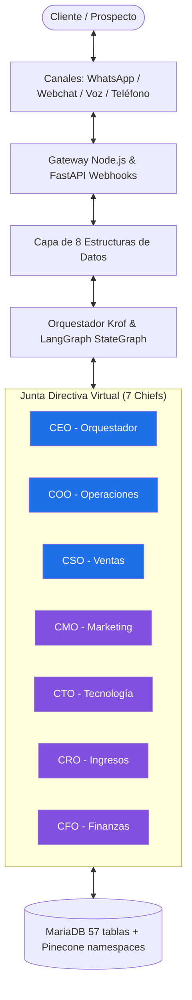
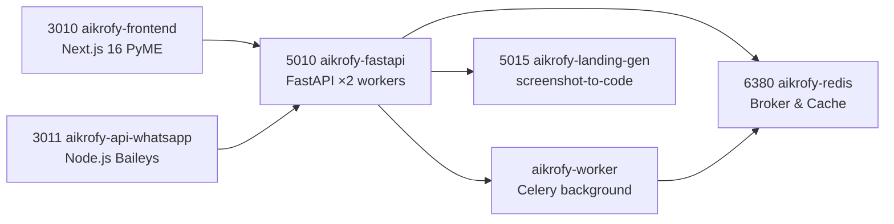
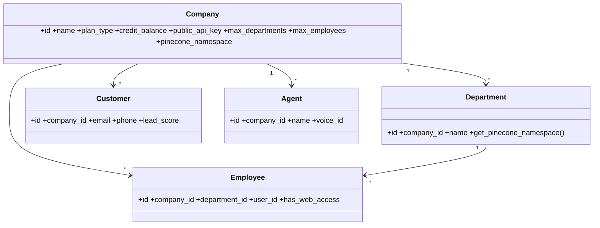
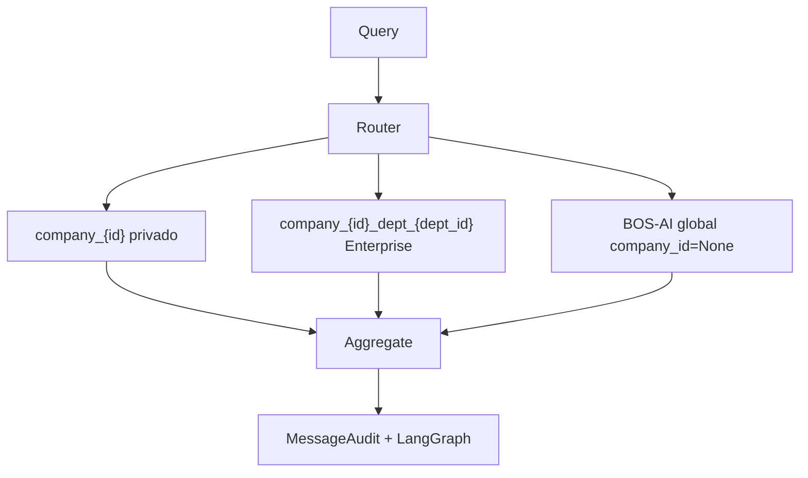
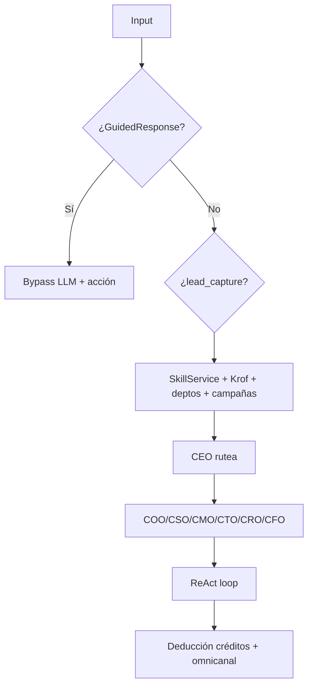
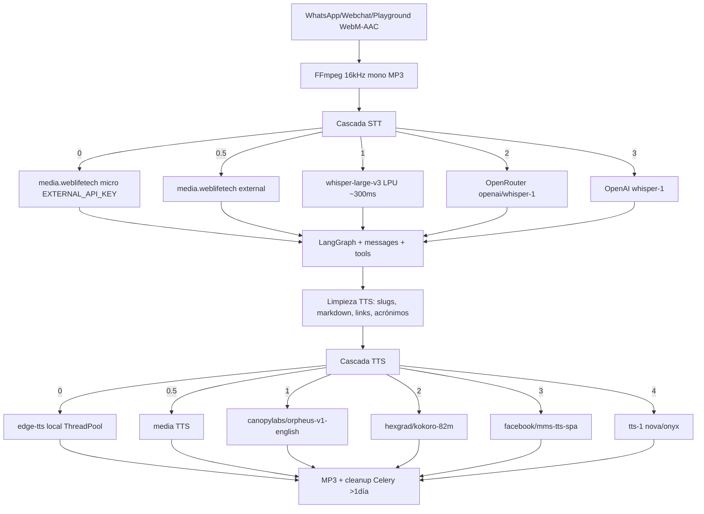

# 📖 COMPENDIO MAESTRO & DOSSIER TÉCNICO DEFINITIVO — PLATAFORMA AIKROFY (V4.0)

**Titularidad & Propósito:** Iniciativa oficial de **FUNDACIÓN UNDERLIFE** para la democratización de la automatización agéntica y el empoderamiento económico de personas naturales y jurídicas.
**Desarrollo & Arquitectura:** Diseñado y construido con ingeniería de vanguardia por **WEBLIFETECH** (Jonnathan Peña).
**Modelo de Distribución:** Open-Core bajo licencia *PolyForm Noncommercial 1.0.0* (Community Edition) & Cloud Multi-tenant gestionado en `aikrofy.com`.
**Sistema:** Aikrofy Multi-Agent Ecosystem & High-Performance Agentic Operating System
**Dominio Oficial:** `aikrofy.com` · **Repo:** `/root/aikrofy` · rama `dev`
**Versión del Dossier:** 4.0 (Consolidación definitiva desde auditoría real de producción)
**Fecha de Publicación:** 26 de septiembre de 2026 (auditoría: `pm2 list`, `ss -tlnp`, `rg`, grafo `root-aikrofy` 10 598 nodos / 31 320 aristas)
**Lectura:** `README.md` → `ESTRUCTURA_PROYECTO.md` → `GEMINI.md` + `AGENTS.md` → este dossier → `docs/` (planes, integraciones, análisis, legacy).

> **Nota de honestidad técnica:** este dossier corrige cifras de documentos legacy (que decían "34 modelos / 48 servicios / 34 rutas"). Las cifras vigentes son **57 tablas / 41 ficheros de modelos, 96 ficheros de servicios, 45 ficheros de rutas / ~335 endpoints**, verificadas el 26-sep-2026. La app enterprise separada (:3012) se eliminó el 26-sep-2026 (sin tráfico); el resto de desfases (restarts PM2, nombres legacy) se marca con ⚠️ en vez de ocultarse. El detalle histórico vive en `docs/`.

---

# 📑 TABLA DE CONTENIDOS

1. [Visión holística, identidad y protocolo IAGS](#1-visión-holística-identidad-y-protocolo-iags)
2. [Topología de infraestructura, microservicios y puertos PM2](#2-topología-de-infraestructura-microservicios-y-puertos-pm2)
3. [Capa de aceleración de las 8 estructuras de datos](#3-capa-de-aceleración-de-las-8-estructuras-de-datos-fundamentales)
4. [Directorio de base de datos relacional (57 tablas)](#4-directorio-de-base-de-datos-relacional-57-tablas-sqlalchemy-20)
5. [Multi-tenant, RAG vectorial y contención por departamentos](#5-aislamiento-multi-tenant-rag-vectorial-y-contención-por-departamentos)
6. [Arquitectura cognitiva: 7 Chiefs con Krof](#6-arquitectura-cognitiva-y-la-junta-directiva-virtual-7-chiefs-con-krof)
7. [Catálogo de herramientas IA (LangGraph ReAct tools)](#7-catálogo-de-herramientas-de-ia-langgraph-react-tools)
8. [Directorio de servicios backend (96 módulos)](#8-directorio-de-servicios-backend-96-módulos)
9. [Directorio de rutas y endpoints API (45 módulos / ~335 endpoints)](#9-directorio-de-rutas-y-endpoints-api-45-módulos--335-endpoints)
10. [API REST pública V1 y servidor MCP](#10-catálogo-de-api-rest-pública-v1-y-servidor-model-context-protocol-mcp)
11. [Audio, voz multimodal y telefonía CPaaS](#11-subsistema-de-audio-voz-multimodal-y-telefonía-cpaas)
12. [Atribución omnicanal, CRM conversacional y lead scoring](#12-atribución-omnicanal-crm-conversacional-y-lead-scoring-predictivo)
13. [Integración empresarial: ERPs, pagos y e-commerce](#13-módulos-de-integración-empresarial-erps-pasarelas-de-pago-y-e-commerce)
14. [Innovaciones agénticas](#14-innovaciones-agénticas-respuestas-guiadas-campañas-y-landing-pages)
15. [Economía: tokenomics y copy](#15-economía-del-sistema-tokenomics-costos-gpt-5-nano-y-estrategia-de-copy)
16. [Auditoría 26-sep-2026, deuda técnica y veredicto](#16-auditoría-de-producción-26-sep-2026-deuda-técnica-y-veredicto)

---

# 1. VISIÓN HOLÍSTICA, IDENTIDAD Y PROTOCOLO IAGS

## 1.1. El ADN de Aikrofy: fuerza laboral agéntica 360° (AWaaS)
**Aikrofy** (`aikrofy.com`) no es un creador de chatbots. Es un **Sistema Operativo Agéntico B2B** que despliega una **Junta Directiva Virtual (C-Suite de 7 Chiefs)** y fuerza laboral autónoma para el ciclo comercial, operacional, técnico y financiero, orquestada alrededor de **Krof**, el copiloto cognitivo central, sobre grafos de estado cíclicos (**LangGraph**, grafo real de 2 nodos `agent ⇄ tools`).



PyME y corporaciones servidas en `frontend/` :3010 (52 páginas, 5 idiomas; plan `enterprise` por `plan_type`) — la app enterprise separada (:3012, landing de 3 ficheros sin tráfico) se eliminó el 26-sep-2026, ver §16.

## 1.2. Formalismo IAGS V1.4 (filosofía de ingeniería; spec original en `docs/legacy/SKILL_Agentic-Engineering-Protocol_IAGS.md`)
### A. Valor agéntico ($V$):
$$V = \left(P_{\text{difficult}} \times T_{\text{radical}}\right)^{\text{Execution}} \times \text{Moat}$$
* **$P_{\text{difficult}}$**: fricción operativa (ventas 24/7 perdidas, agenda lenta, datos dispersos).
* **$T_{\text{radical}}$**: LLMs frontera + grafos de estado + HNSW + aceleración de estructuras.
* **$\text{Execution}$**: estabilidad DB, latencias µs, cero caídas.
* **$\text{Moat}$**: multi-tenant inmutable + RAG híbrida (empresa + BOS-AI) + MCP.
### B. Escalamiento de impacto ($I$):
$$I = \left(\frac{T_{\text{symbiosis}}}{\text{Fricción}}\right)^{\text{Virality}} \times (D_{\text{immutable}} + H_{\text{sovereign}})$$
* **$T_{\text{symbiosis}}$**: IA + humano (handover, `CompanySkill` dinámicas). **Fricción → 0** (`<0.1ms` auth, `3ms` trie, `2ms` CFO).

---

# 2. TOPOLOGÍA DE INFRAESTRUCTURA, MICROSERVICIOS Y PUERTOS PM2

Ecosistema heterogéneo desacoplado bajo **PM2** (`ecosystem.config.js`, 6 apps, todas `online` el 26-sep-2026):



### Tabla maestra de producción (verificada `pm2 list` + `ss -tlnp`):
| Proceso PM2 | Puerto | Stack | Rol | Estado 26-sep-2026 |
|---|---|---|---|---|
| `aikrofy-redis` | `6380` | Redis 7+ `--bind 127.0.0.1` | Broker Celery + caché | online |
| `aikrofy-frontend` | `3010` | Next 16.1.6 / React 19 | Dashboard PyME (52 páginas) | online ⚠️ 849 restarts/6D |
| `aikrofy-fastapi` | `5010` | Python / Uvicorn `--workers 2` | Núcleo cognitivo + REST v1 + MCP | online ⚠️ 248 restarts/2D, `max_memory_restart 500M` |
| `aikrofy-worker` | — (broker 6380/0) | Celery | Audio, RAG, ML, landings, pulsos | online ⚠️ 138 restarts/2D |
| `aikrofy-api-whatsapp` | `3011` | Node.js `dist/app.js` | WhatsApp Baileys multi-tenant | online (80/2D) |
| `aikrofy-landing-gen` | `5015` | Uvicorn `main:app ×2` | Generación landing pages | online |
| Extra | `3306 mariadbd`, `80/443 nginx` | — | DB + dominios custom | OK; cohabita `enpiai-*` |

---

# 3. CAPA DE ACELERACIÓN DE LAS 8 ESTRUCTURAS DE DATOS FUNDAMENTALES

```mermaid
graph TD
    S1["1. Hash Map O(1) auth_cache <0.1ms"]:::ok
    S2["2. Max-Heap O(1) Top lead_heap <0.1ms"]:::ok
    S3["3. Trie O(L) crm_trie 3ms"]:::ok
    S4["4. Typed Arrays NumPy analytics 2ms 60FPS"]:::ok
    S5["5. Linked List O(1) SlidingWindowMemory"]:::ok
    S6["6. Queues FIFO api-whatsapp + Celery 6380"]:::ok
    S7["7. Stacks LIFO routing.py delegación"]:::ok
    S8["8. Graphs LangGraph + Pinecone HNSW"]:::ok
    classDef ok fill:#166534,color:#fff
```



1. **Hash Maps** (`auth_cache_service.py`): hashes `public_api_key` en memoria con TTL; valida V1/MCP sin `SELECT` por llamada.
2. **Max-Heaps** (`lead_heap_service.py`): prospectos por `lead_score`; CSO/CRO obtienen el top sin `ORDER BY`.
3. **Tries** (`crm_trie_service.py`): nombres/emails/teléfonos; autocomplete a medida que se escribe.
4. **Typed Arrays** (`analytics_vector_service.py`, NumPy Float64): CAC/LTV/MRR/ROI a 60 FPS para el CFO.
5. **Linked Lists** (`SlidingWindowMemory` en `langgraph_agent.py`): últimos 20 mensajes sin recolocar arrays.
6. **Queues FIFO**: outbox WhatsApp + Celery sobre Redis 6380.
7. **Stacks LIFO** (`routing.py`): pila de delegaciones CEO→sub-agente y retorno de contexto.
8. **Graphs**: LangGraph cíclico + HNSW Pinecone.
Evidencia de auditoría: `docs/analisis/AUDITORIA_FINAL_ESTRUCTURAS_Y_DATOS_AIKROFY.md` (matriz antes/después), `docs/analisis/INFORME_ESTRUCTURAS_DATOS_AIKROFY.md` (detalle), plan ejecutado en `docs/legacy/PLAN_IMPLEMENTACION_ESTRUCTURAS_AIKROFY.md`.

---

# 4. DIRECTORIO DE BASE DE DATOS RELACIONAL (57 TABLAS, SQLALCHEMY 2.0)

`backend/models/` — **41 ficheros / 57 tablas** (conteo `^class`, excl. Enums). Todo con aislamiento `company_id`. Corrección: docs legacy decían 34 — obsoleto.



**Inventario verificado:** `AgencyCompanyAccess` · `Agent`, `AgentFeature` · `PredefinedMetric`, `UserDashboard`, `DashboardWidget` · `Appointment` · `BetaLead` · `CampaignQRCode`, `QRCodeScanEvent` · `Channel` · `Company` · `CompanyAgentGraph` · `CompanyCampaign` · `CompanySkill` · `ContactAttribution`, `WebReferralSession` · `Conversation`, `Message` · `CRMConfig` · `Customer` · `Department` · `Document` · `DynamicAction` · `EcommerceConfig` · `EmailLog` · `Employee` · `ERPConfig` · `FunnelStage` · `GuidedResponse(+Action)` · `UserIpLog`, `BlockedIp`, `UserDevice` · `LandingPage(+Version/Visit/Element/CustomDomain)` · `CompanyMCPServer` · `CompanyMediaAsset` · `MessageAudit` · `ModularAsset`, `AssetLicense` · `Note` · `PaymentGatewayConfig`, `PaymentTransaction` · `PlatformConfig` · `PurchasedNumber` · `Plan`, `Subscription` · `TenantScoringConfig` · `Transaction` · `TrustGuardrail` · `User` · `WhatsAppTemplate` · `WhatsAppLidMapping` (mapeo LID→teléfono por empresa, ver §16).
Detalle por fichero en `ANALISIS_SISTEMA_COMPLETO` (ahora `docs/analisis/`) y mapa en `ESTRUCTURA_PROYECTO.md §2`.

### 🛑 Estabilidad DB ("Gone Away")
Pool `5/5/120s/pre-ping` + `_resilient_remove()` · `rollback()` al inicio de cada tool · primitivizar antes de LLM (prohibido `agent.company.name` post-LLM) · `db` solo a nivel módulo · `db_session.remove()` por request · sync aditivo `scripts/sync_db_schema.py` en `deploy.sh`/`start-local.sh`/arranque (cero Error 1054). MariaDB `:3306` primario; `aikrofy.db` 12KB + `instance/` solo fallback dev.

---

# 5. AISLAMIENTO MULTI-TENANT, RAG VECTORIAL Y CONTENCIÓN POR DEPARTAMENTOS

Pinecone (`aikrofy-rag`; alias legacy `pymai-rag`/`onepunch-rag` por normalizar) con 3 niveles:



- **RAG** (`rag_service.py` 394 lín.): `chunk 1000/200`, `upsert_document` vía Celery `index_document_rag`, `routes/rag.py` 16 endpoints (upload, upload-voice, query, crawl-website, sync-*). Override `Company.pinecone_namespace`.
- **Cuotas (`EnterpriseLimits`):** `pyme 1/10` · `enterprise 5/50` · `enterprise_plus 20/200` · `custom` a medida. `has_web_access` True→`User`, False→mensajería.

---

# 6. ARQUITECTURA COGNITIVA Y LA JUNTA DIRECTIVA VIRTUAL (7 CHIEFS CON KROF)

Núcleo `langgraph_agent.py` (1087 lín., `477-497`): grafo **2 nodos** `agent ⇄ tools` + `should_continue` → `END`; `MemorySaver` volátil; `gpt-4o-mini`/`gpt-5-nano` 0.7.



| Chief | Rol | Plan |
|---|---|---|
| CEO Orquestador | intención + delegación (`gpt-4o-mini` 0.0) | todos |
| COO Operaciones | Calendar/Meet, Sheets, ERP | todos |
| CSO Ventas | cierre + heap | todos |
| CMO Marketing | copy + `CompanyCampaign` | enterprise |
| CTO Tecnología | MCP + skills | enterprise |
| CRO Ingresos | funnel + carritos | enterprise |
| CFO Finanzas | LTV/CAC/MRR/ROI NumPy 60FPS | enterprise |

**Skills dinámicas:** sin hardcode en Python; `SkillService` ensambla el system prompt desde MySQL + disco; `agent_list_skills` / `agent_create_or_update_skill` para auto-mejora.

---

# 7. CATÁLOGO DE HERRAMIENTAS DE IA (LANGGRAPH REACT TOOLS)

Registro en `backend/services/langgraph_tools.py` (+ `voice_tools.py`); detalle histórico en `docs/analisis/ANALISIS_SISTEMA_COMPLETO.md`.
- **RAG:** `consult_knowledge_base(query)` (privado + BOS-AI en paralelo).
- **Skills/Agentes:** `agent_list_skills`, `agent_create_or_update_skill`, `agent_create_new_agent`, `agent_delete_agent`.
- **CRM:** `lookup_customer` (trie; **obligatorio antes de precios**), `register_customer` (ML score + sync HubSpot/Salesforce), `crm_get_contact`, `crm_create_deal`, `crm_update_deal_stage`.
- **Pagos:** `paypal_create_order`, `paypal_capture_order` (→`COMPLETED` + resuelve chat), `paypal_get_order`.
- **Mensajería:** `send_whatsapp` (Baileys :3011 / Twilio), `send_email` (HTML), `make_call` (LiveKit SIP / Twilio).
- **Agenda:** `schedule_appointment` (pytz + Meet, consensual), `check_availability`.
- **ERP/E-commerce:** `erp_query_records`, `erp_get_invoice`, `erp_create_customer`; `search_ecommerce_products`, `check_ecommerce_stock`, `create_ecommerce_order`.
- **Blog/LEGO:** `blog_create_article`, `blog_modify_style`, `blog_sync_mediasuite`.

---

# 8. DIRECTORIO DE SERVICIOS BACKEND (96 MÓDULOS)

`backend/services/` — **57 top-level + subpaquetes = 96 ficheros** (legacy decía 48). Núcleo: `langgraph_agent`, `agent_service`, `krof_agent_service`, `skill_service`, `graph_compiler`, `dynamic_tools`, `mcp_service`, `rag_service`, `llm_service`, `cache/cache_service`, `auth_cache`, `token_credit`, `lead_scoring` + `ml_scoring_pipeline` + `local_predictive`, `lead_heap`, `crm_trie`, `analytics_vector`, `autonomous_consciousness`, `trust_guardrail`, `brain_events`, `handover`, `escalation`, `employee_detection`, `enterprise_limits`, `ip_security`, `customer`, `transaction`, `attribution`, `geo_analytics`, `sentiment`, `permission/auth_guard`, `voice_service`, `livekit`, `realtime`, `meeting`, `media`, `pdf`, `landing_generation`, `website_crawler`, `ingestion`, `dlocal_go`, `paddle`, `paypal`×2, `messaging`, `whatsapp_baileys`, `meta_whatsapp`, `meta_template`, `twilio`, `email`, `google` + `google_risc`, `hubspot_sync` · `crm/` 9 (base, factory, hubspot, salesforce, zoho, pipedrive, dynamics, mapper, canonical) · `erp/` 5 + `drivers/` 6 (sap_b1, netsuite, odoo, dynamics_bc, contifico, mysql) · `ecommerce/` 7 (shopify, woocommerce, magento, bigcommerce, vtex, prestashop) · `payment_gateways/` factory + `adapters/` 8 (stripe, paypal, mercadopago, kushki, nuvei, dlocal_go, authorize_net, custom) · `integrations/` 2 (calendar, google_sheets). Mapa por fichero en `ESTRUCTURA_PROYECTO.md §2`.

---

# 9. DIRECTORIO DE RUTAS Y ENDPOINTS API (45 MÓDULOS / ~335 ENDPOINTS)

`backend/routes/` — **45 ficheros** (43 + `v1/agents.py`, `v1/knowledge.py`); **~335 endpoints** (325 `rg @*.route(` + ~10 nativos). Montaje: `fastapi_routes_loader.py:59-99` (38 routers `/api/*`) + `fastapi_app.py:165-180` (`attributions/skills/mcp/v1`) + `fastapi_routers.py` (auth + ERP).
Top: `landing_pages 24`, `channels 17`, `rag 16`, `companies 15`, `admin 15`, `webhooks 13`, `billing 12`, `agents 11`, `campaign_qr 11`, `crm 10`, `employees 10`, `enterprise 10`, `chat 9`, `mcp 6 + skills 9`, `payments 6`, `payment_gateways 7`, `twilio 7`, `google_auth 7`, `hubspot 2`. Incluye `beta` (captación tolerante + fallback `employee_count/industry` + geo-IP + sync Tenant 1), `marketplace` (HMAC-SHA256 por tenant+dominio), `telemetry`, `knowledge_graph`, `funnel_live`, `livekit_routes`, `meetings`, `media`, `ecommerce`, `departments`, `customers`, `demo`, `roles`, `voice` + `voice_agent_api`, `whatsapp_templates`.

---

# 10. CATÁLOGO DE API REST PÚBLICA V1 Y SERVIDOR MODEL CONTEXT PROTOCOL (MCP)

(Fusión de `docs/legacy/CATALOGO_API_MCP.md` + `docs/legacy/ARQUITECTURA_API_FIRST.md`.)
```http
X-API-Key: <public_api_key>   # validada <0.1ms por AuthHashMapCache
```
- **Agentes:** `POST /v1/agents/invoke` (`{agent_name, prompt, session_id}` → respuesta + tools + créditos) · `GET /v1/agents/list` (filtrado por `plan_type`; catálogo 7) · `GET /v1/agents/skills`.
- **Conocimiento:** `POST /v1/knowledge/ingest` · `POST /v1/knowledge/query` (HNSW privado + BOS-AI) · `DELETE /v1/knowledge/{doc_id}`.
- **MCP** (`routes/mcp.py` + `mcp_service.py`, `mcp==1.28.1`): `GET/POST /api/companies/{id}/mcp` (registro `{name,label,description,url,headers,is_active}`) · `PUT/DELETE …/{server_id}` · `POST …/toggle` · `POST …/test` (descubre tools + esquemas). `MCPService.get_tools_for_company()` → `StructuredTool` al ReAct loop.
- **Aislamiento:** todo filtrado por `company_id` autenticado; cada invocación descuenta créditos (0 y no `-1` → bloqueo); cambios invalidan caché.

---

# 11. SUBSISTEMA DE AUDIO, VOZ MULTIMODAL Y TELEFONÍA CPAAS

(Fusión de `docs/legacy/GUIA_IMPLEMENTACION_VOZ.md`; estado: implementado y en producción sep-2026.)

Voces `es-EC-*` (`tasks.py:477-479`); `VoiceService.resolve_smart_voice` por género/idioma; `ThreadPoolExecutor` anti-bloqueo event loop; pre-alocar `output_path`; LiveKit WebRTC SIP `<300ms` + Twilio CPaaS (SMS, voz, WhatsApp Flows, carruseles, `validate/search/purchase-number`).

---

# 12. ATRIBUCIÓN OMNICANAL, CRM CONVERSACIONAL Y LEAD SCORING PREDICTIVO

- **Atribución sin sesión:** CTWA (`referral`/`ctwa_clid`) · GCLID cross-ref (`REF-XXXX` en `wa.me?text=`) · smart links UTM · `ContactAttribution` + `WebReferralSession`. Análisis origen en `docs/analisis/Analisis_y_Diseno_CRM_Conversacional.md`.
- **Lead scoring híbrido:** $$\text{Score} = (w_{\text{ML}} \times P_{\text{ML}} \times 100) + (w_{\text{Manual}} \times S_{\text{Manual}})$$ reglas (rol, dominio, país) + XGBoost re-entrenado en Celery (`train_company_ml_model_task`, decay `01:00`); `TenantScoringConfig` por empresa; heap O(1) para CSO/CRO; avance Kanban automático (`FunnelStage`).
- **HubSpot bidireccional:** `hubspot_sync_service` + `routes/hubspot.py` (Inbox Conversations; plan completo en `docs/planes/PLAN_DE_INTEGRACION_HUBSPOT.md`); factory con salesforce/zoho/pipedrive/dynamics.

---

# 13. MÓDULOS DE INTEGRACIÓN EMPRESARIAL: ERPS, PASARELAS DE PAGO Y E-COMMERCE

Specs completas en `docs/integraciones/` (resumen):
- **ERPs** (`Integracion-ERP.md`, 80KB): modelos canónicos Pydantic V2 + passthrough; drivers `sap_b1` (OData v4/Service Layer), `netsuite` (SuiteTalk), `odoo` (ORM), `dynamics_bc`, `contifico`, `mysql`; endpoints en `fastapi_routers.py:174-237`.
- **Pagos** (`Integracion-Pasarelas-de-Pago.md`, 140KB, el mayor): factory `PaymentAdapterFactory` + 8 adapters (stripe, paypal, mercadopago, kushki, nuvei, dlocal_go, authorize_net, custom) + `PaddleService` (Billing v2, firmas, checkout, recargas) + `DLocalGoService` (planes, checkout) + `PayPalService` (órdenes/suscripciones); rutas `billing 12`/`payments 6`/`payment_gateways 7`. ⚠️ `GatewayProvider` sin `PADDLE`/`CUSTOM` (Paddle fuera del factory) — normalizar.
- **E-commerce** (`research_ecommerce.md` → hoy `services/ecommerce/` 7): shopify (GraphQL), woocommerce, magento, bigcommerce, vtex, prestashop.
- **Calendarios** (`Integracion-de-Calendarios-para-Agentes.md`, sep-2026, la más reciente): Google Calendar/Meet + M365 Graph/Teams, `getSchedule`, transcripts.
- **Twilio** (`Integracion-Avanzada-de-Twilio.md`): SMS/voz/WA, flows sin catálogo, criptografía. **CRM** (`Integración-CRM.md`): salesforce/hubspot/pipedrive/zoho/d365 + discovery custom.

---

# 14. INNOVACIONES AGÉNTICAS: RESPUESTAS GUIADAS, CAMPAÑAS Y LANDING PAGES

(Fusión de `docs/planes/PLAN_INNOVACION_AIKROFY.md`.)
1. **`GuidedResponse`:** `trigger_phrases` → respuesta exacta + acciones (p.ej. pago) con bypass LLM (cero alucinación).
2. **`CompanyCampaign`:** contexto temporal prioritario al system prompt (Black Friday etc.) sin re-entrenar RAG.
3. **Landings IA** (`landing_generation_service` + `routes/landing_pages.py` 24 + Celery `generate_landing_page` con refund 50/10 + `screenshot-to-code` :5015): desde texto/screenshot, dominios CNAME (`nginx-custom-domains.conf`).
4. **`MessageAudit`:** chunk IDs por respuesta; "excluir fragmento" veta vectores erróneos.
5. **Beta blindada** (`beta.py` + `BetaLead` + `beta-register` 8 pasos + `localStorage aikrofy_beta_form` + `admin/beta`): validación tolerante, fallbacks, geo-IP, sync Tenant 1, aprobación 1-clic con credenciales Krof.
6. **LEGO** (`marketplace` + `ModularAsset`/`AssetLicense` HMAC + `process_agentic_blog_content` con MediaSuite/Pexels + interceptor WhatsApp/voz + `templates/blog-template-blank/` + `marketplace/page.tsx`).

---

# 15. ECONOMÍA DEL SISTEMA: TOKENOMICS, COSTOS GPT-5 NANO Y ESTRATEGIA DE COPY

(Fusión de `docs/planes/ANALISIS_RENTABILIDAD_TOKENS_CREDITOS.md` + `ANALYSIS_AND_COPY_STRATEGY.md`.)
- **Costos GPT-5 nano:** in $0.05/1M · out $0.40/1M · cached $0.005/1M (‑90%) · **~$0.00021/mensaje (1 crédito; +infra ~$0.00121)**.
- **Planes:** Jab **$29** (2 000 créd., ~250 convos, costo ~$2.42, **91.6%**) · Uppercut **$99** (10 000, ~1 250+CRM, ~$12.10, **87.7%**) · Knockout **$299** (40 000, ~5 000+voz+ERP, ~$48.40, **83.8%**).
- **Copy B2B:** *"Aikrofy: tu primer empleado de élite que nunca duerme. No un chatbot: fuerza virtual 360° que vende, agenda, cobra y sincroniza inventario en WhatsApp y Web."*
- **Copy VC:** *"Aikrofy construye el Agentic OS de la empresa inteligente: orquestación stateful LangGraph + datos en microsegundos + facturación por consumo, márgenes >85%."*

---

# 16. AUDITORÍA DE PRODUCCIÓN 26-SEP-2026, DEUDA TÉCNICA Y VEREDICTO

### Auditoría (qué se verificó)
`pm2 list` (6/6 online) · `ss -tlnp` (6380/3010/5010/3011/5015 + 3306 + 80/443) · `ecosystem.config.js` · `requirements.txt` + `package.json`×3 · `models/` (41f/57t) · `routes/` (45f/~335ep) · `services/` (96f) · `fastapi_app.py:33/165-180/205-461`, `fastapi_routes_loader.py:59-99`, `fastapi_routers.py:174-237`, `celery_app.py:24-25/51-68`, `tasks.py:195-541/291/477-479`, `config.py:44-54/68/130-131`, `rag_service.py:61`, `langgraph_agent.py:477-497`, `models/department.py:105` · frontends (52 + 22 + landing-gen) · 27 .md (690KB, 8 217 lín., fechas git may-2025→sep-2026).

### Deuda técnica priorizada
1. **Restarts PM2:** fastapi 248, worker 138 (2D), frontend 849 (6D) — investigar OOM/loops/fugas antes del release (P0).
2. **Nombres legacy:** `PymAI Gateway v2.2.0`, `pymai-frontend`, `whatsapp-api-yt`, Pinecone triple, `.env.example` `onepunch`/puertos viejos (P1). la app enterprise separada (:3012) eliminada el 26-sep-2026 (P0 ejecutado).
3. **`tasks.py` → `app.create_app`/`extensions.db`** con `app.py` mock (P1); `GatewayProvider` sin PADDLE/CUSTOM; `celery 6379` vs `6380`; `MemorySaver` volátil; `ENTERPRISE_ONLY_ROLES` vs 4 enterprise (P2).
4. **`whatsapp_lid_mapping` normalizada el 26-sep-2026** (respaldo del feature broadcast/LID/push_name): existía una tabla manual con PK compuesta que no coincidía con el código; se migró a `id` autoincremental + única `(company_id, lid_jid)` según el modelo `WhatsAppLidMapping`, con flujo upsert probado y 3 filas preservadas. `qrcodly/` vacío, shims raíz, `FRONTEND_GUIDE.md` obsoleto → `docs/legacy/` (P3).

### Veredicto
**Aikrofy V4.0: homologado y en producción** — 6/6 PM2 online, núcleo cognitivo + RAG + voz + WhatsApp + V1/MCP + 8 estructuras operativos; MariaDB 57 tablas + Pinecone + Redis 6380; `frontend/` :3010 completo (52 páginas/5 idiomas, planes pyme+enterprise por `plan_type`); integraciones pagos/CRM/ERP/e-commerce/Twilio/Google reales; economía >83% margen. Este dossier + `GEMINI.md`/`AGENTS.md`/`ESTRUCTURA_PROYECTO.md` sustituyen a los 22 documentos legacy archivados en `docs/`.

---

**Desarrollado y certificado por Jonnathan Peña para WEBLIFETECH.**
