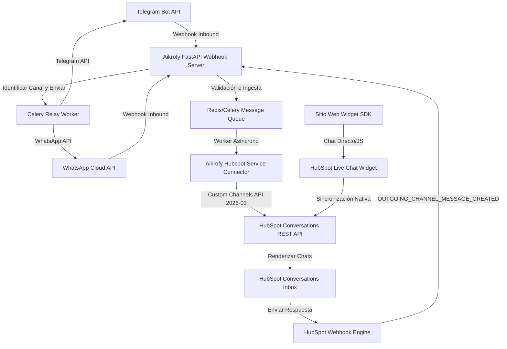

# Plan de Implementación: Integración de Canales Conversacionales con HubSpot Inbox (Aikrofy)

Este documento detalla el plan técnico, la arquitectura y las especificaciones de integración para unificar todos los canales de comunicación de **Aikrofy** (Telegram, WhatsApp y el Widget de Chat Web) con la **bandeja de entrada (Inbox) de HubSpot**. El objetivo principal es que todos los mensajes entrantes se almacenen y visualicen de forma unificada identificando su canal de origen, y que cualquier respuesta enviada desde el Inbox de HubSpot se propague automáticamente al canal correspondiente en tiempo real.

---

## 1. Arquitectura de Integración Bidireccional

Para soportar la sincronización en tiempo real sin interferir con el rendimiento del motor conversacional multiagente de Aikrofy (basado en `LangGraph` y `FastAPI`), implementamos una arquitectura desacoplada y orientada a eventos.

### Diagrama de Flujo de Datos (Inbound y Outbound)



---

## 2. Estrategia por Canal de Comunicación

### A. WhatsApp & Telegram (Custom Channels API - 2026-03)
Para canales externos que no tienen soporte HTML directo nativo en HubSpot, utilizamos la **API de Canales Personalizados (Custom Channels)**.
* **Canal en HubSpot**: Registramos dos canales personalizados distintos:
  * `Telegram - Aikrofy`
  * `WhatsApp - Aikrofy`
* **Identificación del Actor**:
  * Para Telegram, el `deliveryIdentifier` será `CHANNEL_SPECIFIC_OPAQUE_ID` con el formato `telegram_{user_id}` o el `username`.
  * Para WhatsApp, el `deliveryIdentifier` será `HS_PHONE_NUMBER` con el número telefónico del cliente en formato E.164.
* **Modelo de Hilos**: Configurado como `INTEGRATION_THREAD_ID` para que Aikrofy asocie de forma unívoca cada conversación con su identificador interno (`telegram_chat_id` o `whatsapp_chat_id`).

### B. Widget de Chat Web (SDK de HubSpot + Visitor Identification)
El widget web se incrusta mediante el script de seguimiento oficial de HubSpot. 
* **Widget SDK**: Controlado en el frontend usando el objeto global `window.HubSpotConversations`.
* **Identificación del Visitante**: Para evitar chats anónimos fragmentados, cuando el usuario inicia sesión en Aikrofy o proporciona sus datos, el frontend consulta a la API de Aikrofy para obtener un **Token de Identificación de Visitante**. Este token se genera consumiendo el endpoint de HubSpot:
  `POST /visitor-identification/2026-03/tokens/create`
  Luego se inicializa en el widget usando el SDK para sincronizar automáticamente el perfil con el CRM.

---

## 3. Especificaciones del API de Canales Personalizados

### A. Registro del Canal Personalizado (One-Time Setup)
Para habilitar que WhatsApp o Telegram aparezcan en la bandeja de entrada de HubSpot, debemos registrar la integración realizando un `POST` utilizando las credenciales de la App (Client ID/Secret o Developer API Key):

* **Endpoint**: `POST https://api.hubapi.com/conversations/2026-03/custom-channels`
* **Headers**:
  ```http
  Authorization: Bearer <DEVELOPER_TOKEN_OR_OAUTH_TOKEN>
  Content-Type: application/json
  ```
* **Cuerpo de Solicitud (WhatsApp)**:
  ```json
  {
    "name": "WhatsApp - Aikrofy",
    "webhookUrl": "https://api.aikrofy.ai/v1/integrations/hubspot/webhooks",
    "capabilities": {
      "deliveryIdentifierTypes": ["HS_PHONE_NUMBER"],
      "richText": [],
      "allowInlineImages": true,
      "allowOutgoingMessages": true,
      "outgoingAttachmentTypes": ["FILE"],
      "threadingModel": "INTEGRATION_THREAD_ID"
    },
    "channelDescription": "Canal de WhatsApp Business unificado para Aikrofy",
    "channelLogoUrl": "https://aikrofy.ai/assets/logos/whatsapp.png"
  }
  ```

### B. Publicar Mensaje Entrante en HubSpot
Cuando el cliente envía un mensaje a través de WhatsApp o Telegram:

* **Endpoint**: `POST https://api.hubapi.com/conversations/2026-03/custom-channels/{channelId}/messages`
* **Headers**:
  ```http
  Authorization: Bearer <ACCESS_TOKEN>
  Content-Type: application/json
  ```
* **Cuerpo de Solicitud (WhatsApp - Inbound)**:
  ```json
  {
    "text": "Hola, ¿pueden ayudarme con una cotización?",
    "channelAccountId": "account_whatsapp_prod",
    "messageDirection": "INCOMING",
    "integrationThreadId": "chat_whatsapp_573001234567",
    "integrationIdempotencyId": "msg_wa_unique_id_998877",
    "senders": [
      {
        "deliveryIdentifier": {
          "type": "HS_PHONE_NUMBER",
          "value": "+573001234567"
        },
        "name": "Carlos Gomez"
      }
    ],
    "recipients": [
      {
        "deliveryIdentifier": {
          "type": "HS_PHONE_NUMBER",
          "value": "+18005550199"
        },
        "name": "WhatsApp Business Aikrofy"
      }
    ]
  }
  ```

---

## 4. Flujo de Sincronización y Webhooks (Outbound)

Cuando un agente responde desde la bandeja de entrada de HubSpot, este emite un evento del tipo `OUTGOING_CHANNEL_MESSAGE_CREATED` hacia nuestro `webhookUrl`.

### Payload del Webhook Recibido en Aikrofy
```json
{
  "type": "OUTGOING_CHANNEL_MESSAGE_CREATED",
  "portalId": "9876543",
  "channelId": "chan_telegram_pym_123",
  "eventTimestamp": "2026-07-10T17:18:22Z",
  "message": {
    "id": "hubspot_msg_987654",
    "text": "Hola Carlos, con gusto. ¿A qué correo te enviamos la propuesta?",
    "direction": "OUTGOING",
    "channelAccountId": "account_telegram_prod"
  },
  "channelIntegrationThreadIds": [
    "chat_telegram_883749221"
  ]
}
```

### Lógica de Reenvío en el Servidor Webhooks (Aikrofy)
1. **Identificación**: A partir de `channelId` y `channelAccountId`, la base de datos de Aikrofy reconoce si corresponde a Telegram o WhatsApp.
2. **Dirección**: Obtiene el identificador del destinatario a partir del `channelIntegrationThreadIds` (que almacena el ID de chat interno original).
3. **Despacho**: Delega al módulo de mensajería asíncrona (`celery_app.py`) la llamada a la API nativa de WhatsApp Cloud o Telegram Bot para entregar el mensaje al cliente final.

---

## 5. Implementación Técnica en Código (Pymai/Backend)

### A. Módulo del Conector de HubSpot (`hubspot_connector.py`)
Agregamos los métodos para manejar las APIs de Custom Channels y Visitor Token a la clase `HubSpotConnector`.

```python
# Ubicación sugerida: aikrofy/backend/services/crm/hubspot_connector.py (Añadir métodos)

import requests
from typing import Dict, Any, List

class HubSpotConnector:
    # ... código existente ...

    def create_visitor_token(self, email: str, first_name: str = None, last_name: str = None) -> Dict[str, Any]:
        """
        Genera un token de identificación de visitante autenticado para el Widget de Chat.
        """
        url = f"{self.crm_url}/visitor-identification/2026-03/tokens/create"
        payload = {
            "email": email,
            "firstName": first_name,
            "lastName": last_name,
            "hsCustomerAgentContext": {}
        }
        
        resp = self._safe_request("POST", url, headers=self._get_headers(), json=payload)
        return resp.json()  # Retorna {"token": "eyJhbGci..."}

    def publish_custom_channel_message(
        self, 
        channel_id: str, 
        thread_id: str, 
        message_text: str, 
        sender_identifier: str, 
        sender_name: str,
        is_whatsapp: bool = True,
        idempotency_id: str = None
    ) -> Dict[str, Any]:
        """
        Publica un mensaje (de WhatsApp o Telegram) en un canal personalizado de HubSpot.
        """
        url = f"{self.crm_url}/conversations/2026-03/custom-channels/{channel_id}/messages"
        
        sender_type = "HS_PHONE_NUMBER" if is_whatsapp else "CHANNEL_SPECIFIC_OPAQUE_ID"
        
        payload = {
            "text": message_text,
            "channelAccountId": "default_account_pym",
            "messageDirection": "INCOMING",
            "integrationThreadId": thread_id,
            "senders": [
                {
                    "deliveryIdentifier": {
                        "type": sender_type,
                        "value": sender_identifier
                    },
                    "name": sender_name
                }
            ],
            "recipients": [
                {
                    "deliveryIdentifier": {
                        "type": "CHANNEL_SPECIFIC_OPAQUE_ID",
                        "value": "pym_system_receiver"
                    }
                }
            ]
        }
        
        if idempotency_id:
            payload["integrationIdempotencyId"] = idempotency_id
            
        resp = self._safe_request("POST", url, headers=self._get_headers(), json=payload)
        return resp.json()
```

### B. Endpoint de Webhook para Respuestas desde HubSpot (`fastapi_routers.py`)
Endpoint para recibir eventos `OUTGOING_CHANNEL_MESSAGE_CREATED` y retransmitirlos al usuario final.

```python
# Ubicación sugerida: aikrofy/backend/routes/hubspot_webhooks.py (o integrado en fastapi_routers.py)

from fastapi import APIRouter, Request, HTTPException, Depends
from services.crm.hubspot_connector import HubSpotConnector
import logging

router = APIRouter(prefix="/v1/integrations/hubspot", tags=["hubspot"])
logger = logging.getLogger(__name__)

@router.post("/webhooks")
async def hubspot_webhook_receiver(request: Request):
    payload = await request.json()
    
    event_type = payload.get("type")
    if not event_type:
        raise HTTPException(status_code=400, detail="Invalid webhook format")
        
    if event_type == "OUTGOING_CHANNEL_MESSAGE_CREATED":
        message_data = payload.get("message", {})
        text = message_data.get("text")
        channel_id = payload.get("channelId")
        thread_ids = payload.get("channelIntegrationThreadIds", [])
        
        if not thread_ids or not text:
            return {"status": "ignored", "reason": "Missing thread id or text"}
            
        target_thread_id = thread_ids[0]  # e.g., "chat_whatsapp_573001234567" o "telegram_12345"
        
        # Enrutar el mensaje según el canal origen
        if "telegram" in channel_id.lower() or target_thread_id.startswith("telegram_"):
            # Lógica para enviar vía Telegram Bot API
            chat_id = target_thread_id.replace("telegram_", "")
            logger.info(f"Relaying HubSpot message to Telegram chat {chat_id}")
            # telegram_service.send_message(chat_id, text)
            
        elif "whatsapp" in channel_id.lower() or target_thread_id.startswith("chat_whatsapp_"):
            # Lógica para enviar vía WhatsApp Cloud API
            phone = target_thread_id.replace("chat_whatsapp_", "")
            logger.info(f"Relaying HubSpot message to WhatsApp number {phone}")
            # whatsapp_service.send_message(phone, text)
            
        return {"status": "dispatched", "thread": target_thread_id}
        
    return {"status": "received", "event": event_type}
```

---

## 6. Frontend: Configuración del SDK del Widget & Identificación

En la interfaz del usuario corporativo o portal de clientes de **Aikrofy** (`enterprise-frontend` o `frontend`), debemos cargar el widget con el token de identificación para garantizar la vinculación directa con su perfil de HubSpot CRM.

```html
<!-- Ubicación sugerida: index.html o componente global de layout en React/Vue -->

<script type="text/javascript">
  // Configuración inicial de HubSpot settings
  window.hsConversationsSettings = {
    loadImmediately: false // Esperamos a obtener la identidad del usuario
  };

  // Función ejecutada cuando HubSpot Conversations esté listo
  function onConversationsAPIReady() {
    console.log("HubSpot Conversations SDK inicializado correctamente.");
  }

  window.hsConversationsOnReady = [onConversationsAPIReady];

  // Función para autenticar e identificar al visitante en el Chat Widget
  async function initHubSpotWidgetForUser(userEmail, firstName, lastName) {
    try {
      // 1. Obtener Token de Identificación de Visitante desde el backend de Aikrofy
      const response = await fetch('/api/v1/integrations/hubspot/visitor-token', {
        method: 'POST',
        headers: { 'Content-Type': 'application/json' },
        body: JSON.stringify({ email: userEmail, firstName, lastName })
      });
      
      const data = await response.json();
      const visitorToken = data.token;

      // 2. Pasar el token de identificación al widget de HubSpot
      if (window.HubSpotConversations) {
        window.HubSpotConversations.widget.load({
          identify: {
            token: visitorToken
          }
        });
      } else {
        window.hsConversationsOnReady.push(() => {
          window.HubSpotConversations.widget.load({
            identify: {
              token: visitorToken
            }
          });
        });
      }
    } catch (error) {
      console.error("Error al inicializar el widget de chat con identificación:", error);
      // Fallback: cargar el widget de forma anónima
      if (window.HubSpotConversations) {
        window.HubSpotConversations.widget.load();
      }
    }
  }
</script>
```

---

## 7. Plan de Trabajo y Siguientes Pasos

1. **Fase 1: Configurar Credenciales e Infraestructura**
   * Crear la App de Integración en el Developer Portal de HubSpot.
   * Configurar los scopes requeridos: `conversations.custom_channels.read`, `conversations.custom_channels.write` y `conversations.read`.
2. **Fase 2: Registrar Canales en HubSpot**
   * Ejecutar script único en Pymai para registrar los canales personalizados de WhatsApp y Telegram.
   * Guardar los `channelId` resultantes en las variables de entorno (`.env`).
3. **Fase 3: Implementar Sincronización Inbound (De Canales a HubSpot)**
   * Agregar triggers en los receptores de webhooks existentes de WhatsApp y Telegram para que copien e inserten el mensaje en HubSpot Inbox usando `publish_custom_channel_message`.
4. **Fase 4: Configurar Sincronización Outbound (De HubSpot a Canales)**
   * Habilitar la ruta en FastAPI para procesar el webhook `OUTGOING_CHANNEL_MESSAGE_CREATED`.
   * Implementar cola de reenvío para evitar problemas de cuotas o caídas de red temporales.
5. **Fase 5: Autenticación de Widget (Chat Web)**
   * Implementar endpoint de creación de tokens en FastAPI.
   * Integrar el código Javascript del SDK en el Portal Frontend de Aikrofy.
